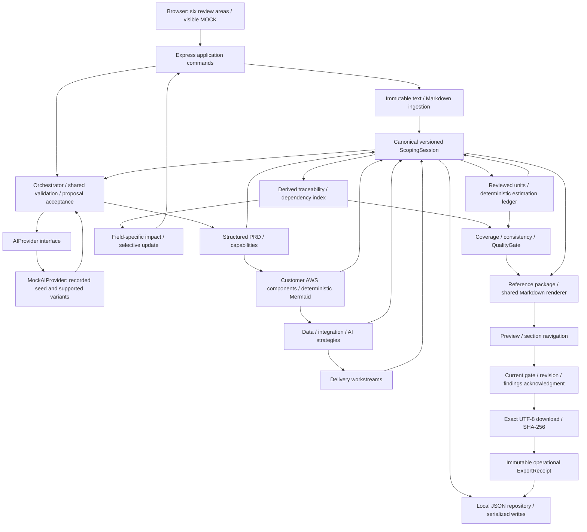

# Submission architecture

The assistant is a local single-user TypeScript application. AWS is the generated **customer solution** platform; running this assistant needs no AWS account, model service or credentials.

Provider output is untrusted structured input. The application allocates IDs, validates source offsets and grounding, and merges only accepted proposals. MockAI never supplies authoritative effort, duration or money. Exact-rational estimation, role rates, minor-unit rounding and pooled phase scheduling stay in their Phase 3 engines.

The dependency index is derived from canonical InputRefs and grounding. Changes invalidate the quality snapshot and only stale substantive consumers. The latest human change evidence survives generated updates; unchanged IDs, payloads and review stamps remain inspectable.

The package is an ephemeral reference composition, not another editable document store. It binds domain revision, gate/rules/findings hash, section IDs/revisions, estimation rules, template and disclaimer versions. Both preview and HTTP download call the same renderer. Export reruns quality and checks the captured token inside the repository's serialized operational transaction. A concurrent domain save either precedes export and makes its request stale, or follows the committed export; content never mixes revisions.

PASS permits export; REVIEW_REQUIRED needs explicit acknowledgment bound to revision and findings hash; BLOCKED cannot export. Warnings remain in Markdown. Re-evaluation preserves a previously reported browser diagram failure until the user reruns quality. A PASS is only a deterministic consistency result.

Receipts are append-only evidence in the session, with no document body. They include exact-byte SHA-256, timestamp, revision, gate/version/findings, template/disclaimer, section revisions, rules and acknowledgment where applicable. The latest receipt shortcut may be cleared on edits; history persists. A receipt records server export issuance, not proof that a user retained a downloaded file.

Local storage is plaintext under .data by default, with one previous recovery snapshot. The server binds loopback, checks Host/Origin, validates IDs and request schemas, never accepts an export path, and does not log customer input. Markdown customer text is escaped; preview renders React text nodes with no HTML/active SVG. Mermaid remains lazy-loaded in the architecture workspace.

The separate customer architecture in each package shows accepted AWS service components, their rationale and grounding, Mermaid source and readable node/connection inventories. It does not depict deployment of this assistant.

